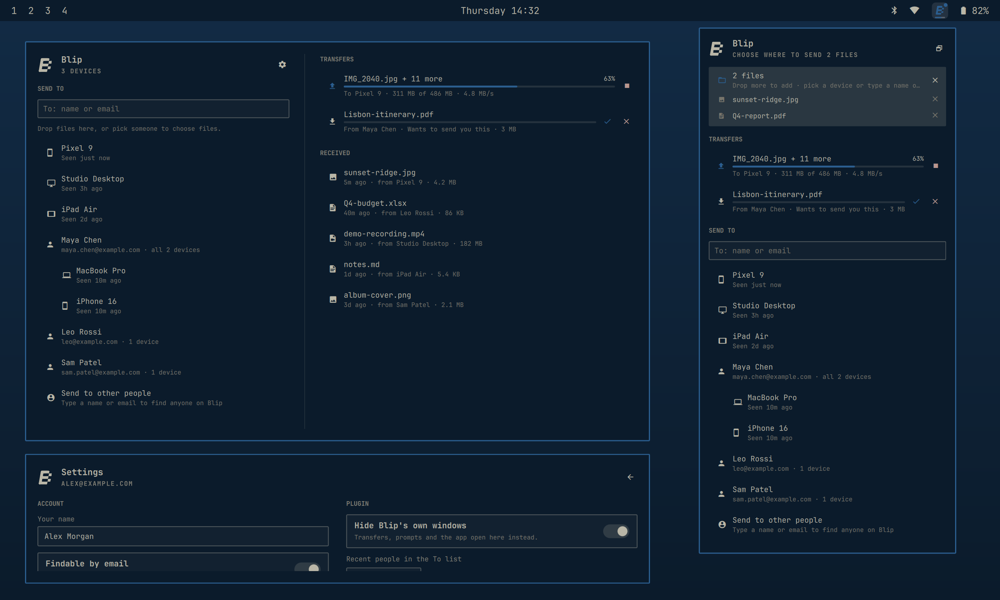

# Blip for Omarchy

An Omarchy bar plugin for [Blip](https://blip.net), the app for sending files of any size to your own devices and to other people. Drop a file on the Blip mark in the bar, pick where it goes, and it's on its way. Blip's own windows stay out of sight, and a themed Omarchy window takes their place.

> Unofficial. This plugin is not made by or affiliated with Blip. It drives the Blip app that you install on your machine.



## What it does

- **Send by drag and drop.** Drop files on the bar mark or into the panel, then pick one of your devices or a person. You can queue several files before choosing.
- **Send to anyone.** Type a name or email in the **To** field and the plugin looks them up through Blip. If someone has more than one device, you can send to all of them or pick one. The list keeps only the people you've recently sent to.
- **Follow transfers.** Each transfer shows its progress, speed and a Stop button. A thin progress line also appears under the bar mark.
- **Answer incoming files.** When someone offers you files, Accept or Decline them right in the panel.
- **See what came in.** The panel lists your most recent received files. Click one to open it, or show it in your file manager. Files that could run code when opened, such as `.desktop`, scripts or AppImages, are always shown in their folder instead of opened.
- **An Omarchy window instead of Blip's.** Right-click the mark, or open Blip from the app launcher, to get a wide themed window with the same features plus settings.
- **Settings in the same style.** The window's settings page covers Blip's own settings (name, device name, findable by email, auto-accept from your devices, save folder, speed limits, diagnostics, log out) and this plugin's settings.
- **First-run setup.** If Blip isn't installed, the panel offers to install it. New users sign in from the panel: enter your email, type the code Blip emails you, and add your name.

| Mouse on the bar mark | Does |
| --- | --- |
| Left click | Open the panel |
| Right click | Open the Blip window |
| Middle click | Open the folder Blip saves received files to |
| Drop files | Queue them to send |

## Requirements

- Omarchy with the Quickshell-based Omarchy shell and Hyprland's Lua config (Omarchy Quattro).
- **Blip for Linux**, from the AUR package [`blipnet`](https://aur.archlinux.org/packages/blipnet).
- **zenity**, for the file and folder pickers.
- `python3`, `busctl` and `wl-clipboard`, which ship with Omarchy.

You don't need to install Blip or zenity yourself. When they're missing, the panel shows an **Install Blip** button. It opens Omarchy's floating terminal and runs `omarchy-pkg-add zenity && omarchy-pkg-aur-add blipnet`, so you can watch the install and enter your password there. The plugin never installs anything without that click.

## Install

```bash
omarchy plugin add https://github.com/tarax28/omarchy-blip --enable
```

Then click the Blip mark in the bar. If Blip isn't installed yet, follow the setup steps in the panel.

## Remove

```bash
omarchy plugin remove tarax.blip
```

This removes the plugin only. Blip itself stays installed. To remove it too:

```bash
yay -Rns blipnet
```

When the plugin is removed or disabled, it switches off the window rules it added to Hyprland, so Blip's own windows appear again.

## Settings

Open the Blip window (right-click the mark) and click the gear. The plugin settings are also in Omarchy's shell settings:

| Setting | Default | Meaning |
| --- | --- | --- |
| Hide Blip's own windows | on | Blip's windows go to a hidden workspace, and this plugin's window opens instead |
| Recent people in the To list | 5 | How many people you've sent to are listed |
| Received files to list | 10 | How many received files the panel shows |
| Check Blip every | 5 s | How often to re-read Blip's state while it isn't running |

## Command line

```bash
omarchy-shell tarax.blip toggle            # open or close the panel
omarchy-shell tarax.blip window            # open or close the Blip window
omarchy-shell tarax.blip settings          # open the settings page
omarchy-shell tarax.blip drop "/path/a.pdf"
omarchy-shell tarax.blip send Phone "/path/a.pdf"
omarchy-shell tarax.blip devices           # list your devices
```

## How it works

- `state.py` talks to the running Blip app over its local socket (`~/.cache/net.blip.Blip/sock`), the same interface Blip's own window uses. It reads devices, transfers and received files, and asks Blip to accept, decline, stop, search, sign in and change settings. Without a running Blip, it reads Blip's saved state file. It never prints your Blip sign-in token.
- Files are sent with Blip's own command line (`blip --peer=… --file=…`).
- A Hyprland window rule sends Blip's windows (class `MainKt`, title ending in `Blip`) to a hidden special workspace. Opening Blip from the launcher shows this plugin's window instead. The gear's **Open Blip's window** button still shows the real one.

## Security notes

- Like every Omarchy plugin, this runs unsandboxed inside the shell. Read the code before you install it.
- The only package installs are the ones above, and they run in a visible terminal after you click **Install Blip**.
- Sign-in codes are passed to the helper on standard input, never on the command line.
- Window addresses from Hyprland events are checked before they are used in Hyprland Lua calls.
- Received files that could run code when opened are revealed in their folder, never opened directly.
- `omarchy-shell tarax.blip send/drop` can be called by any program running as your user. It can only send to your own devices.

## License

[MIT](LICENSE)
